## Hi there, I'm Iqbal 👋

🎓 **Informatics Graduate** from Universitas Ahmad Dahlan (UAD), specializing in **Digital Forensics**, **Network Security**, and **Software Engineering**. I love bridging hardware prototyping and software automation to solve real-world operational and cybersecurity problems.

---

<picture data-importer="pacman">
  <source media="(prefers-color-scheme: dark)" srcset="https://raw.githubusercontent.com/Iqbalarbani/Iqbalarbani/pacman-output/pacman-contribution-graph-dark.svg?game=pacman">
  <source media="(prefers-color-scheme: light)" srcset="https://raw.githubusercontent.com/Iqbalarbani/Iqbalarbani/pacman-output/pacman-contribution-graph.svg?game=pacman">
  
</picture>

### 🚀 About Me
- 🔭 **Currently working on:** Network automation & wireless security research, logistics/technical operations systems, and full-stack web tools.
- 🛡️ **Background:** Former Forensic Laboratory Practicum Assistant at UAD.
- 🛠️ **Notable Project:** *ATTRACTHOR Network Automation* — a portable forensic logging prototype combining ESP8266/ESP8285, Raspberry Pi, and a Python 3 + PyQt6 desktop app for experimental analysis of Wi-Fi Deauthentication & Evil Twin attacks.
- 💬 **Ask me about:** Digital Forensics, Wi-Fi Security, Network Analysis, Python Automation, Web Development, or IoT prototyping.
- ⚡ **Fun fact:** When I'm not analyzing packets or writing code, you can find me playing traditional Bangka music, crocheting, hiking mountains, or live-streaming gameplay.

---

### 💻 Tech Stack & Tools

**Languages**

       

**Frameworks, Hardware & Platforms**

     

**Cybersecurity, Network & Forensic Tools**

     

**Dev, GIS & 3D Tools**

     

---

<!-- ### 📊 GitHub Stats

  
  

 -->

<!-- ini watermark saya hehe -->

### 📫 Connect with Me

  
  
  

